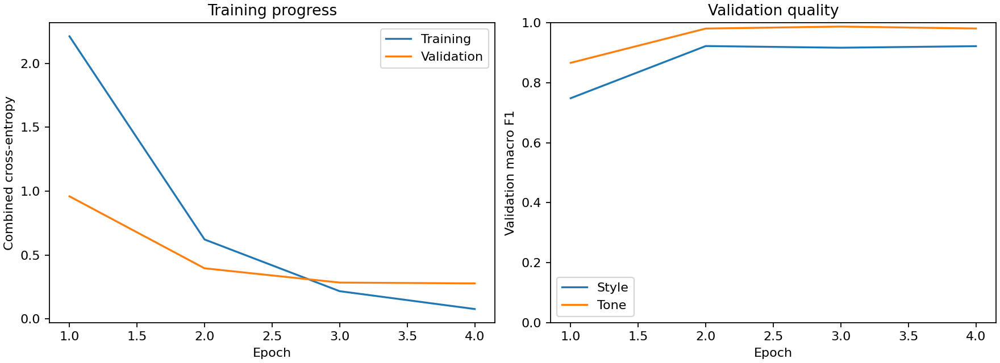
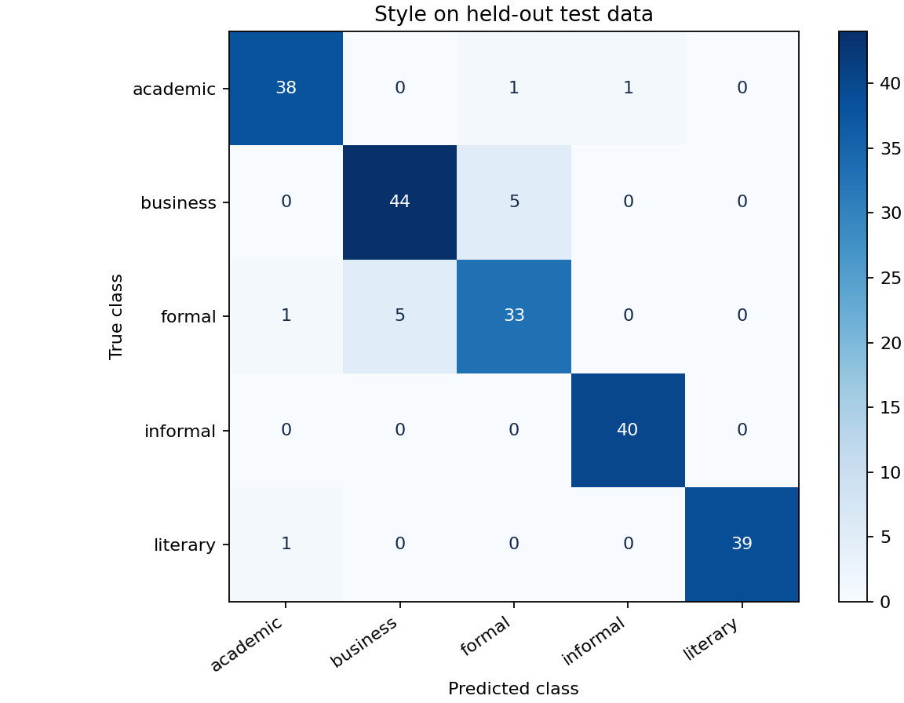
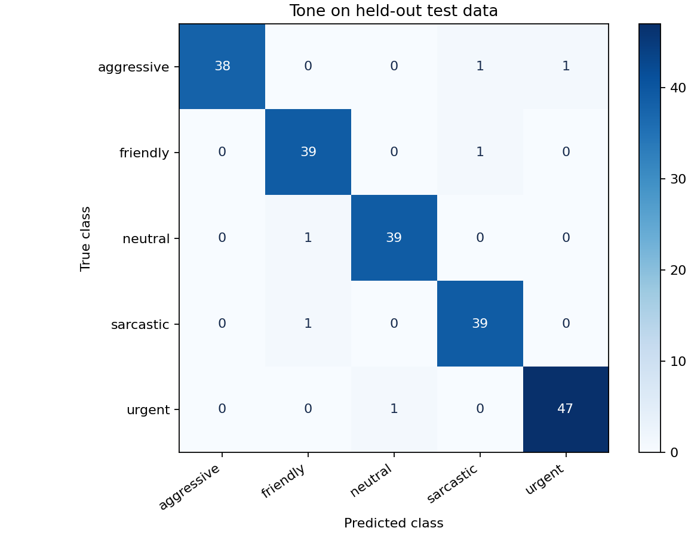

# TextScope — Text Style & Tone Detection with Deep Learning

Застосунок для визначення **стилю та комунікативного тону англомовного тексту**. Проєкт поєднує підготовку даних, навчання трьох нейромереж, оцінювання якості, REST API на FastAPI та вебінтерфейс на Streamlit.

Один текст отримує дві мітки: наприклад, діловий стиль і дружній тон. Для цього кожна модель має спільний нейромережевий енкодер і два окремі класифікаційні виходи. У комплектному експерименті за валідаційною метрикою обрано **DistilBERT**; також доступні **TextCNN** та **BiLSTM з attention pooling**.

Проєкт розвиває задачу з [класичної ML-версії zave52/text-style-detection](https://github.com/zave52/text-style-detection). Порівняння реалізацій, результатів та методів навчання наведено нижче.

> **Мова вхідних текстів — англійська. Мова інтерфейсу — українська.** Для запуску готових моделей повторне навчання не потрібне. Застосунок працює на CPU; CUDA необов’язкова.

## Зміст

- [Можливості](#можливості)
- [Швидкий старт](#швидкий-старт)
- [Режими запуску](#режими-запуску)
- [REST API](#rest-api)
- [Структура репозиторію](#структура-репозиторію)
- [Дані та поділ](#дані-та-поділ)
- [Нейромережеві моделі](#нейромережеві-моделі)
- [Результати комплектного експерименту](#результати-комплектного-експерименту)
- [Порівняння з початковим проєктом](#порівняння-з-початковим-проєктом)
- [Машинне та глибинне навчання](#машинне-та-глибинне-навчання)
- [Навчання та відтворення](#навчання-та-відтворення)
- [Ноутбуки](#ноутбуки)
- [Перевірка коду](#перевірка-коду)
- [Типові проблеми](#типові-проблеми)
- [Обмеження](#обмеження)
- [Джерела](#джерела)

## Можливості

| Задача | Доступні класи |
|---|---|
| Стиль | `academic` — академічний; `business` — діловий; `formal` — офіційний; `informal` — неформальний; `literary` — художній |
| Тон | `aggressive` — агресивний; `friendly` — дружній; `neutral` — нейтральний; `sarcastic` — саркастичний; `urgent` — терміновий |

Тут тон охоплює емоційне й комунікативне забарвлення повідомлення. Це класифікація за п’ятьма заданими категоріями, а не стандартна шкала «позитивний / негативний / нейтральний».

- Аналіз одного повідомлення, розподіли оцінок за класами та завантаження результату в JSON.
- Пакетний аналіз CSV з колонкою `text`: від 1 до 32 рядків, файл до 5 МіБ у вебінтерфейсі.
- API для обох міток, окремого стилю, окремого тону та пакетних запитів.
- Вкладка якості зі збереженими метриками, кривими навчання й матрицями помилок.
- Аудит корпусу, спільний поділ даних для всіх нейромереж, перевірка перетинів і контрольних сум.
- Температурне калібрування оцінок на validation та попередження про обрізання, невідомі токени й невпевнені прогнози.
- Локальне передбачення за збереженими вагами й токенізатором, без викликів зовнішніх мовних API.

## Швидкий старт

### Вимоги

- **Python 3.11–3.13** згідно з `pyproject.toml`; рекомендована версія для початку — **Python 3.12**. CI використовує Python 3.12.
- [Git](https://git-scm.com/downloads) та [Git LFS](https://git-lfs.com/) для отримання ваг трансформера.
- Інтернет для встановлення залежностей і першого завантаження файлів. Після цього готові моделі виконують передбачення локально.

Основні технології: PyTorch **2.8.0**, Transformers **4.57.1**, FastAPI, Streamlit, pandas, NumPy, scikit-learn і Matplotlib. scikit-learn використовується для поділу даних та метрик; класифікатори застосунку реалізовані в PyTorch.

### 1. Завантажити репозиторій і ваги

```bash
git lfs install
git clone https://github.com/PavloMolytovnyk/text_style_detection_deep_learning.git
cd text_style_detection_deep_learning
git lfs pull
```

Файл `artifacts/transformer/model/weights.pt` зберігається через Git LFS і має розмір близько **249 МіБ**. Після завантаження ZIP замість ваг іноді залишається короткий текстовий LFS-покажчик. Для запуску потрібні самі ваги; рекомендований спосіб отримати їх — клонування з Git LFS.

### 2. Створити середовище та встановити залежності

**Windows, Git Bash:**

```bash
python -m venv .venv
source .venv/Scripts/activate
python -m pip install --upgrade pip
python -m pip install torch==2.8.0 --index-url https://download.pytorch.org/whl/cpu
python -m pip install -r requirements.txt
```

**Linux:**

```bash
python3 -m venv .venv
source .venv/bin/activate
python -m pip install --upgrade pip
python -m pip install torch==2.8.0 --index-url https://download.pytorch.org/whl/cpu
python -m pip install -r requirements.txt
```

**macOS:** створіть середовище як у прикладі Linux, а PyTorch встановіть командою `python -m pip install torch==2.8.0` зі звичайного індексу PyPI. Далі встановіть `requirements.txt`.

У **Windows PowerShell** можна обійтися без активації середовища:

```powershell
python -m venv .venv
.\.venv\Scripts\python.exe -m pip install --upgrade pip
.\.venv\Scripts\python.exe -m pip install torch==2.8.0 --index-url https://download.pytorch.org/whl/cpu
.\.venv\Scripts\python.exe -m pip install -r requirements.txt
.\.venv\Scripts\python.exe run.py
```

### 3. Запустити вебінтерфейс

В активованому середовищі, з кореня репозиторію:

```bash
python run.py
```

Відкрийте **[http://localhost:8501](http://localhost:8501)**. На вкладці «Аналіз тексту» вставте англомовне повідомлення та натисніть «Визначити стиль і тон». Наприклад:

```text
Hey! Thanks for helping me yesterday. You made my day!
```

Інтерфейс покаже дві передбачені мітки, оцінки класів і попередження, якщо вони виникли. Для перегляду комплектних результатів відкрийте вкладку «Якість моделі».

**Альтернативний запуск із автоматичним створенням середовища:** після клонування та отримання LFS-ваг запустіть `start_windows.bat` у Windows або `bash start.sh` у Linux/macOS. Перший запуск встановлює залежності й може тривати довше.

## Режими запуску

Усі команди нижче виконуються з кореня проєкту в активованому середовищі.

| Команда | Результат |
|---|---|
| `python run.py` | Streamlit з локальним завантаженням моделі, порт `8501` |
| `python run.py --mode api` | FastAPI, порт `8000`; Swagger на `/docs` |
| `python run.py --mode both` | FastAPI та Streamlit; інтерфейс звертається до API |
| `python -m textstyle.predict "Thanks for your help!"` | Передбачення у форматі JSON в терміналі |

Swagger після запуску API: **[http://localhost:8000/docs](http://localhost:8000/docs)**. Зупинка процесів — `Ctrl+C` у терміналі запуску.

Порти можна змінити:

```bash
python run.py --mode both --ui-port 8502 --api-port 8001
```

### Вибір готової моделі

За замовчуванням [реєстр активної моделі](artifacts/active_model.json) вказує на `transformer/model`. Для перемикання на іншу комплектну архітектуру:

```bash
python -m scripts.select_model cnn
python run.py
```

Доступні значення: `cnn`, `bilstm`, `transformer`. Після перемикання перезапустіть уже запущений API або інтерфейс. Повернення до DistilBERT:

```bash
python -m scripts.select_model transformer
```

### Налаштування середовища

| Змінна | Призначення |
|---|---|
| `MODEL_DIR` | Шлях до каталогу контрольної точки з `metadata.json`, `weights.pt` та `tokenizer/`; має пріоритет над стандартним реєстром |
| `API_URL` | Адреса FastAPI для Streamlit, наприклад `http://127.0.0.1:8000`; без неї інтерфейс використовує локальний `Predictor` |
| `TORCH_NUM_THREADS` | Кількість потоків CPU для передбачення; типово `2` |

Наприклад, у Git Bash/Linux/macOS:

```bash
MODEL_DIR=artifacts/cnn/model python run.py
```

Передбачення в API та UI за замовчуванням виконується на CPU. Параметр навчання `--device auto` обирає CUDA, якщо вона доступна, інакше CPU.

## REST API

Запуск:

```bash
python run.py --mode api
```

| Метод | Шлях | Призначення |
|---|---|---|
| `GET` | `/` | Відомості про сервіс |
| `GET` | `/health/live` | Перевірка, що процес API працює |
| `GET` | `/health/ready` | Перевірка, що модель завантажена й готова |
| `GET` | `/model/info` | Архітектура, класи, ліміт токенів та метадані моделі |
| `POST` | `/predict` | Стиль, тон і повні відомості про прогноз |
| `POST` | `/predict/style` | Стиль, упевненість, оцінки класів і попередження |
| `POST` | `/predict/tone` | Тон, упевненість, оцінки класів і попередження |
| `POST` | `/predict/batch` | Обробка від 1 до 32 повідомлень |

### Один текст

Приклад для Bash/Git Bash:

```bash
curl -X POST http://localhost:8000/predict \
  -H "Content-Type: application/json" \
  -d '{"text":"Hey! Thanks for your help!"}'
```

Повна відповідь містить такі поля:

| Поле | Зміст |
|---|---|
| `style`, `tone` | Передбачені мітки |
| `style_confidence`, `tone_confidence` | Максимальні оцінки після калібрування та softmax, від `0` до `1` |
| `style_scores`, `tone_scores` | Окремі розподіли оцінок п’яти класів; кожен сумується приблизно до `1` |
| `model` | Назва архітектури |
| `token_count` | Кількість токенів до обрізання за правилами відповідного токенізатора |
| `truncated` | Чи було перевищено ліміт токенів |
| `unknown_ratio` | Частка невідомих токенів в обмеженій послідовності |
| `latency_ms` | Виміряний час підготовки batch і обчислення моделі, поділений на кількість текстів; без завантаження моделі та HTTP-обміну |
| `warnings` | Список попереджень |

Оцінка `0.9` описує впевненість моделі; вона не гарантує правильність конкретного передбачення. `latency_ms` також не є повною затримкою HTTP-запиту.

### Пакет текстів

```bash
curl -X POST http://localhost:8000/predict/batch \
  -H "Content-Type: application/json" \
  -d '{"texts":["Thanks for helping me!","Please send the signed contract today."]}'
```

Відповідь має форму `{"results": [...]}`, де кожний елемент відповідає повній схемі `/predict`.

Для Python-клієнта:

```python
import httpx

response = httpx.post(
    "http://localhost:8000/predict",
    json={"text": "Thanks for your help!"},
    timeout=60,
)
response.raise_for_status()
prediction = response.json()
print(prediction["style"], prediction["tone"])
```

Текст повинен містити хоча б одну літеру; максимальна довжина запиту — **8000 символів на повідомлення**. Ліміт символів не скасовує обмеження моделі за токенами: довші послідовності обрізаються, про що повідомляють `truncated` і `warnings`. Некоректні тіла запиту повертають `422`; недоступна модель — `503`. `/health/live` може відповідати успішно, коли `/health/ready` ще повертає `503`.

## Структура репозиторію

| Шлях | Призначення |
|---|---|
| [textstyle/](textstyle/) | Підготовка даних, токенізація, нейромережі, навчання, оцінювання та `Predictor` |
| [app/](app/) | FastAPI та схеми запитів і відповідей |
| [streamlit_app.py](streamlit_app.py) | Вебінтерфейс |
| [run.py](run.py) | Запуск UI, API або обох процесів |
| [scripts/](scripts/) | Збирання корпусу, повторне оцінювання та вибір моделі |
| [dataset/](dataset/) | Вихідні текстові файли, впорядковані за стилем і тоном |
| [data/raw/](data/raw/) | Початковий CSV-корпус |
| [data/prepared/](data/prepared/) | Очищений корпус, train/validation/test, виключені суперечливі тексти та manifest |
| [artifacts/](artifacts/) | Навчені ваги, токенізатори, метадані, звіти та реєстр активної моделі |
| [notebooks/](notebooks/) | Три послідовні етапи аналізу та експериментів |
| [tests/](tests/) | Перевірки даних, моделей, API та інтерфейсу |
| [requirements.txt](requirements.txt) | Залежності застосунку й навчання |
| [requirements-dev.txt](requirements-dev.txt) | Додаткові інструменти розробки та Jupyter |
| [requirements-lock.txt](requirements-lock.txt) | Зафіксовані версії основних пакетів; файл не є повним lock усіх транзитивних залежностей |
| [pyproject.toml](pyproject.toml) | Метадані пакета та налаштування перевірок |
| [.github/workflows/ci.yml](.github/workflows/ci.yml) | Автоматичні Ruff і pytest у GitHub Actions |

## Дані та поділ

### Походження й очищення

Використано корпус із [початкового проєкту](https://github.com/zave52/text-style-detection): **1000 англомовних прикладів**, 5 стилів × 5 тонів, по 40 прикладів на кожну з 25 комбінацій. Вхідний формат — CSV з колонками `text`, `style`, `tone`.

Підготовка в [textstyle/data.py](textstyle/data.py):

1. Перевіряє необхідні колонки, порожні тексти й допустимі мітки.
2. Нормалізує стару назву стилю `literaly` до `literary` у 200 записах.
3. Зіставляє однакові тексти без урахування регістру та зайвих пробілів. Якщо їхні мітки суперечать одна одній, виключає всю конфліктну групу.
4. Видаляє повторні копії однакових текстів із погодженими мітками, якщо вони є.
5. Групує близькі тексти й формує спільний поділ для всіх моделей.

У комплектному корпусі вилучено **два записи** з однаковим текстом `Respond immediately.` і різними стилями `business` та `formal`. Залишається **998 текстів**; інших точних повторів для видалення не виявлено. Підсумок аудиту міститься в [manifest.json](data/prepared/manifest.json), виключені записи — в [excluded_conflicts.csv](data/prepared/excluded_conflicts.csv).

### Захист від витоку даних

Близькість визначається за множинами словесних триграм: Jaccard ≥ `0.82` або частка включення коротшої множини ≥ `0.95`. Порівняння застосовується, коли обидва тексти мають щонайменше 8 різних триграм, а відношення розмірів множин — не менше `0.5`.

Отримані **968 груп** розподіляються через два послідовні виклики `StratifiedGroupKFold` із п’ятьма фолдами та стратифікацією за парою `style + tone`. Використовуються перші фолди й seed `42` / `43`. Це спосіб побудови одного holdout-поділу, а не п’ятикратне навчання кожної нейромережі.

| Вибірка | Текстів | Використання |
|---|---:|---|
| Train | **632** | Навчання ваг і словника CNN/BiLSTM |
| Validation | **158** | Вибір епохи й архітектури, керування навчанням, калібрування |
| Test | **208** | Підсумкове оцінювання після вибору моделі |

Частки близькі до `64% / 16% / 20%`; точні розміри залежать від груп. Код перевіряє відсутність спільних `sample_id`, `group_id` та однакових нормалізованих текстів між вибірками. Контрольні суми CSV записано в manifest і перевіряються під час завантаження. Евристичне групування зменшує ризик витоку близьких копій, але не доводить відсутність усіх семантично подібних прикладів.

## Нейромережеві моделі

Усі архітектури мають **спільний енкодер та два виходи по п’ять логітів**. Функція втрат — сума `CrossEntropy(style)` і `CrossEntropy(tone)`. Обидві задачі спільно впливають на навчання енкодера.

| Архітектура | Представлення та обробка тексту | Параметрів у комплектній моделі |
|---|---|---:|
| **TextCNN** | Навчувані embeddings розмірності 128; `Conv1d` з вікнами 3, 4, 5 і 96 каналами на вікно; ReLU, маскований max pooling, dropout `0.4` | 940 138 |
| **BiLSTM + attention** | Навчувані embeddings 128; двонапрямна LSTM з hidden size 96 на напрям; attention pooling і фінальні стани; dropout `0.4` | 967 115 |
| **DistilBERT** | Донавчання `distilbert/distilbert-base-cased`; представлення першого спеціального токена; dropout `0.3` і два класифікатори | 65 198 602 |

**CNN і BiLSTM** навчаються з нуля на train. Їхній словник будується лише за train, містить до 12 000 токенів і зберігає пунктуацію; слова нормалізуються через `casefold`, а верхній регістр позначається токеном `<upper>`. Використовуються динамічне доповнення batch та ліміт 256 токенів. Для LSTM застосовано packed sequences, для згорток — маскування позицій доповнення.

**DistilBERT** починає з попередньо навченого англомовного cased-енкодера. Під час fine-tuning оновлюються енкодер і обидва класифікаційні виходи. Комплектна контрольна точка використовує ліміт **192 токени**, включно зі спеціальними токенами. При передбаченні токенізатор і ваги завантажуються з локального каталогу моделі.

Базовий DistilBERT отримав мовні представлення до цього експерименту; класи стилю й тону він вивчає під час донавчання. Тому порівняння з CNN/BiLSTM одночасно відображає різницю архітектур і перевагу попереднього навчання.

## Результати комплектного експерименту

Джерело — [artifacts/experiment.json](artifacts/experiment.json). Усі три нейромережі оцінено на однакових **208 тестових текстах**. Значення F1 наведено в діапазоні `0–1`, joint accuracy — у відсотках.

| Модель | Validation mean macro F1 | Test macro F1: стиль | Test macro F1: тон | Test joint accuracy |
|---|---:|---:|---:|---:|
| TextCNN | 0.8835 | 0.8402 | 0.8927 | 78.37% |
| BiLSTM + attention | 0.8050 | 0.7816 | 0.8420 | 68.27% |
| **DistilBERT** | **0.9518** | **0.9338** | **0.9709** | **90.38%** |

Для DistilBERT accuracy становить **93.27% для стилю** та **97.12% для тону**: відповідно 194 і 202 правильні мітки з 208. Обидві мітки одночасно правильні у **188 текстах**.

**Правило вибору:** найбільше середнє macro F1 двох задач на validation. Test не використовується для вибору архітектури, епохи або температур калібрування.

- **Accuracy** — частка правильно передбачених міток однієї задачі.
- **Macro F1** — середнє F1 п’яти класів з однаковою вагою кожного класу.
- **Weighted F1** — середнє F1 з урахуванням кількості прикладів кожного класу.
- **Joint accuracy** — частка текстів, для яких правильні і стиль, і тон.
- Звіти також містять multiclass ROC-AUC за схемою one-vs-rest, negative log-likelihood, ECE з 10 інтервалами та метрики кожного класу.

У цьому тесті DistilBERT найчастіше плутає `business` і `formal`: по 5 переходів у кожному напрямку. Це видно в [матриці помилок стилю](artifacts/transformer/test/style_confusion.png) і [звіті класів](artifacts/transformer/test/style_report.csv).



<details>
<summary>Матриці помилок DistilBERT</summary>





</details>

Це результати одного збереженого експерименту на невеликому корпусі з seed `42`. Вони не є гарантією якості на довільних повідомленнях; довірчі інтервали та експерименти з кількома seed тут не наведено.

## Порівняння з початковим проєктом

### Що змінилося в реалізації

| Аспект | Початковий проєкт: класичні моделі | Цей проєкт: нейромережі |
|---|---|---|
| Основний класифікатор застосунку | Дві незалежні `TF-IDF + LinearSVC` pipeline | Один спільний енкодер і два виходи; типово DistilBERT |
| Альтернативні експерименти | Усереднені spaCy embeddings + SVM з RBF-ядром або Random Forest | TextCNN та BiLSTM з attention |
| Підготовка тексту | Видалення URL, лематизація spaCy, нижній регістр, збереження пунктуації | Власна токенізація для CNN/BiLSTM або cased subword-токенізатор DistilBERT; без spaCy-лематизації |
| Представлення | TF-IDF уніграм, біграм і триграм або фіксовані вектори слів | Навчувані embeddings і нейромережеві представлення; для DistilBERT — fine-tuning |
| Дані в описаних експериментах | Початкові 1000 прикладів | 998 після усунення конфліктної розмітки |
| Оцінювання | Holdout 80/20 та CV для відповідних класичних експериментів | Спільні train/validation/test з групуванням близьких текстів |
| Вихід API | Мітки стилю та/або тону | Мітки, калібровані оцінки, службові поля, попередження; також batch та health endpoints |
| Збереження | `joblib` для класичних pipeline | `state_dict` PyTorch, JSON-метадані, локальний токенізатор і SHA-256 ваг |
| Інтерфейс | Streamlit і FastAPI; у початковому репозиторії є Docker Compose та Nginx | Streamlit і FastAPI з локальним запуском через `run.py` |

У початковому embedding-експерименті `MultiOutputClassifier` обгортає окремі класичні оцінювачі для двох цілей. Вектори spaCy не донавчаються спільно з цими класифікаторами. Використання готових embeddings саме по собі не перетворює SVM чи Random Forest на end-to-end нейромережу.

### Зіставлення опублікованих результатів

Нижче — **історичні результати різних експериментів**, а не контрольований тест на спільному holdout. Показники класичних моделей взято з [README початкового репозиторію](https://github.com/zave52/text-style-detection/blob/3d894c9cc1f104050511211645369e30d24b7ad0/README.md); вони наведені з точністю джерела й не переобчислювалися в цьому проєкті.

| Модель | Test accuracy: стиль | Test accuracy: тон | Test F1: стиль / тон |
|---|---:|---:|---|
| TF-IDF + LinearSVC | 89% | 94% | Weighted: `0.886 / 0.935` |
| spaCy embeddings + SVM | 87% | 89% | У таблиці джерела наведено CV macro F1, не test F1 |
| spaCy embeddings + Random Forest | 85.5% | 88% | У таблиці джерела наведено CV macro F1, не test F1 |
| TextCNN | 84.13% | 89.42% | Macro: `0.8402 / 0.8927` |
| BiLSTM + attention | 78.37% | 84.62% | Macro: `0.7816 / 0.8420` |
| DistilBERT | 93.27% | 97.12% | Macro: `0.9338 / 0.9709`; weighted: `0.9327 / 0.9712` |

**Чому цього недостатньо для доказу переваги DL над SVM:**

1. У TF-IDF-ноутбуці оригіналу стиль і тон мають окремі стратифіковані поділи 80/20 з seed `42`. У DL використано один спільний поділ 632/158/208 після очищення та групування.
2. У spaCy-експерименті holdout стратифіковано за стилем; наведені CV-оцінки отримано в окремій процедурі. CV F1 не можна підставляти замість test F1.
3. Macro F1 і weighted F1 по-різному враховують класи. Навіть однаково названі метрики не усувають відмінність тестових текстів.
4. DistilBERT використовує попереднє навчання на зовнішньому корпусі; CNN і BiLSTM тут навчаються з нуля.

Отже, DistilBERT має найвищі показники **серед нейромереж цього збереженого експерименту**. Опубліковані цифри класичного проєкту показують сильний результат TF-IDF + LinearSVC, але різницю між репозиторіями не слід подавати як виміряний приріст на одному тесті. Нижчі результати CNN/BiLSTM також показують, що перехід до нейромережі сам по собі не забезпечує покращення.

### Як провести коректне спільне порівняння

Для такого експерименту потрібно перенавчити класичні pipeline на тих самих `data/prepared/train.csv`, використовувати validation для підбору параметрів і лише після фіксації рішень оцінити всі моделі на незмінному `test.csv`. TF-IDF та інші навчувані перетворення мають будуватися тільки за train. Підсумкова таблиця повинна містити однакові macro/weighted F1, accuracy та joint accuracy; витрати пам’яті й затримку слід вимірювати на однаковому обладнанні та batch size.

Такий спільний запуск класичних і нейромережевих моделей у цьому репозиторії не реалізований; наведені вище класичні результати зберігають статус результатів початкового проєкту.

## Машинне та глибинне навчання

**Машинне навчання (ML)** — широка група методів, які навчаються закономірностей за даними. **Глибинне навчання (DL)** — його підмножина, заснована на нейронних мережах із послідовними шарами перетворень. Тому обидва проєкти належать до ML; тут порівнюються **класичне ML та нейромережевий підхід**.

| Питання | Класичний підхід у початковому проєкті | Глибинний підхід у цьому проєкті |
|---|---|---|
| Як формується опис тексту? | TF-IDF рахує ваги слів і n-грам; spaCy-варіант усереднює готові вектори | Енкодер навчає представлення під час оптимізації задачі; DistilBERT починає з попередньо навчених ваг |
| Як ураховується порядок? | N-грами відображають локальний порядок у вибраних вікнах; усереднення векторів його втрачає | CNN шукає локальні шаблони, BiLSTM обробляє послідовність у двох напрямках, Transformer використовує self-attention та позиційну інформацію |
| Що навчається спільно? | У TF-IDF-підході окремі класифікатори стилю й тону | Спільний енкодер і два класифікаційні виходи |
| Як впливає обсяг даних? | TF-IDF + лінійна модель часто є сильним стартом для невеликої текстової вибірки | Навчання з нуля може вимагати більше прикладів; попереднє навчання допомагає переносити мовні представлення, але не усуває потреби перевірки |
| Які ресурси потрібні? | Лінійний класифікатор зазвичай має дешевше передбачення; spaCy-підготовка також створює витрати | Витрати залежать від архітектури: комплектні CNN/BiLSTM мають менш як 1 млн параметрів, DistilBERT — близько 65 млн; усі працюють на CPU |
| Наскільки легко пояснити рішення? | Для лінійного TF-IDF-класифікатора можна дослідити ваги ознак | Внески ознак розподілені між шарами; ваги attention самі по собі не є повним поясненням рішення |

Для невеликого корпусу й обмежених ресурсів TF-IDF + LinearSVC варто зберігати як базову модель. DistilBERT доцільно розглядати, коли важливі контекстні представлення та є ресурс на донавчання й передбачення. Вибір має спиратися на спільне оцінювання якості та вартості роботи, а не лише на назву сімейства алгоритмів.

## Навчання та відтворення

### Підготовка даних

Комплектні вибірки вже готові. Для їх повторного створення з початкового CSV:

```bash
python -m textstyle.data
```

Команда перезаписує підготовлені файли в `data/prepared/`. Для експериментів із власним корпусом краще використати окремий каталог:

```bash
python -m textstyle.data --source path/to/dataset.csv --output experiments/custom_data
```

Для збирання CSV з вихідних TXT:

```bash
python -m scripts.build_dataset
python -m textstyle.data --source data/raw/rebuilt_dataset.csv --output experiments/rebuilt_data
```

`build_dataset` створює `data/raw/rebuilt_dataset.csv`; цей файл не підміняє стандартне джерело автоматично. Для навчання на іншому підготовленому наборі передайте відповідний `--data-dir`.

### Параметри комплектного навчання

| Параметр | CNN / BiLSTM | DistilBERT |
|---|---|---|
| Epoch limit / patience | 35 / 7 | 4 / 2 |
| Batch size | 32 | 8 |
| Learning rate | `0.001` | `0.00002` |
| Max length | 256 | 192 |
| Optimizer | AdamW, weight decay `0.01` | AdamW, weight decay `0.01` |
| Найкраща епоха у збереженому запуску | CNN: 29; BiLSTM: 11 | 3 |

Використовуються gradient clipping `1.0`, `ReduceLROnPlateau`, фіксація seed і рання зупинка за validation mean macro F1. Після відновлення найкращих ваг для кожного виходу підбирається скалярна температура **тільки на validation**. Калібрування змінює розподіл упевненості, а не порядок класів одного прогнозу.

### Новий експеримент

Щоб зберегти комплектні моделі, використовуйте новий `--output`:

```bash
python -m textstyle.train --architectures cnn bilstm --epochs 35 --patience 7 --device cpu --output experiments/reproduce
python -m textstyle.train --architectures transformer --epochs 4 --patience 2 --batch-size 8 --max-length 192 --device cpu --output experiments/reproduce
```

Друга команда додає іншу архітектуру до того самого експерименту за умови однакового manifest даних. Повторно навчати вже наявну архітектуру в той самий каталог не можна — використайте новий шлях. Самі значення seed не гарантують побітово однакових результатів між різними пристроями та версіями бібліотек.

Перше донавчання трансформера потребує доступу до Hugging Face для отримання базового енкодера й токенізатора. Для GPU замініть `--device cpu` на `--device cuda`, встановивши відповідну CUDA-збірку PyTorch за [офіційною інструкцією](https://pytorch.org/get-started/locally/).

Параметри CLI також включають `--data-dir`, `--seed`, `--learning-rate` і `--pretrained`. Якщо не вказати `--architectures`, навчаються **лише CNN та BiLSTM**; типовий CLI-ліміт токенів — **256**, тому для відтворення комплектного DistilBERT явно задано `--max-length 192`.

Новий експеримент записує власний `active_model.json` усередині `--output`. Стандартний реєстр у `artifacts/` від цього не змінюється. Для перевірки нової контрольної точки:

```bash
python -m textstyle.predict "Thanks for your help!" --model-dir experiments/reproduce/transformer/model
```

Або запустіть UI з відповідним `MODEL_DIR`. Переможця нового експерименту дивіться в його `experiment.json`.

### Збережені результати та повторне оцінювання

Для кожної архітектури в `artifacts/<architecture>/` зберігаються:

- `model/weights.pt`, `model/metadata.json`, `model/tokenizer/` — ваги, конфігурація, мітки, температури та токенізатор;
- `history.json`, `learning_curves.png` — історія й графік навчання;
- `test/metrics.json`, `test/predictions.csv`, `test/errors.csv` — метрики, передбачення та помилки;
- `test/style_report.csv`, `test/tone_report.csv`, `test/style_confusion.png`, `test/tone_confusion.png` — звіти за класами та матриці помилок.

Повторне оцінювання готової моделі без навчання:

```bash
python -m scripts.evaluate --model-dir artifacts/transformer/model --output reports/reevaluation
```

Каталог звіту створюється командою. Для власного експерименту передайте його `--model-dir` і, за потреби, `--data-dir`. Скрипт перевіряє відповідність manifest контрольної точки підготовленим даним.

## Ноутбуки

| Ноутбук | Зміст |
|---|---|
| [01_subject_analytics.ipynb](notebooks/01_subject_analytics.ipynb) | Постановка задачі, баланс класів, довжини текстів, первинний аналіз |
| [02_leak_modeling_data.ipynb](notebooks/02_leak_modeling_data.ipynb) | Очищення, перевірка поділу, токенізація, будова моделей, демонстрація forward/backward |
| [03_training_graduate_erorrhandling.ipynb](notebooks/03_training_graduate_erorrhandling.ipynb) | Навчання або читання збереженого експерименту, метрики, ROC, аналіз помилок і нові тексти |

Встановлення та запуск у тому самому середовищі:

```bash
python -m pip install -r requirements-dev.txt
python -m ipykernel install --user --name textscope-dl --display-name "Python (TextScope DL)"
python -m jupyter lab notebooks
```

У Jupyter або VS Code оберіть ядро **Python (TextScope DL)**. У кожному ноутбуці запускайте клітинки згори донизу, починаючи з імпортів: змінні одного `.ipynb` не передаються іншому автоматично. Імпорти та потрібні дані завантажуються окремо в кожному ноутбуці.

У третьому ноутбуці `RUN_TRAINING = False` за замовчуванням читає комплектний `artifacts/experiment.json`. Значення `True` запускає CNN/BiLSTM у `experiments/notebook_run`; для повторного навчання змініть каталог, якщо там уже є моделі. Для донавчання DistilBERT використайте наведений вище CLI.

## Перевірка коду

Після встановлення dev-залежностей:

```bash
python -m ruff check .
python -m pytest -q
```

Тести охоплюють підготовку даних, нейромережі, API та Streamlit-інтерфейс. [GitHub Actions](.github/workflows/ci.yml) виконує Ruff і pytest на Python 3.12 із CPU-збіркою PyTorch та отриманням LFS-файлів. Ці перевірки не замінюють вимірювання якості моделі на новому корпусі.

## Типові проблеми

| Симптом | Дія |
|---|---|
| `ModuleNotFoundError: No module named 'torch'` у ноутбуці | Установіть залежності в `.venv`, зареєструйте його через `ipykernel` і виберіть це ядро. Перевірте `import sys; print(sys.executable)` |
| `PyTorch: 2.8.0+cpu`, `CUDA: False` | Це нормальний результат для CPU-збірки. Готові моделі, ноутбуки й навчання можуть працювати без CUDA |
| `ModuleNotFoundError: textstyle` | Запускайте команди з кореня репозиторію; перевірте вибраний Python/ядро |
| Помилка завантаження ваг або невідповідність SHA-256 | Виконайте `git lfs pull` у клоні, перевірте `MODEL_DIR`. Ваги, metadata і tokenizer повинні належати одній контрольній точці |
| API повертає `503` | Перевірте `/health/ready` і повідомлення в терміналі; наявність процесу ще не означає, що модель завантажилась |
| API повертає `422` | Передавайте правильний JSON, текст з літерами, до 8000 символів; для batch — 1–32 елементи |
| CSV не приймається | Потрібна колонка `text`, 1–32 непорожні повідомлення та файл до 5 МіБ |
| Попередження про обрізання | Скоротіть текст: комплектний DistilBERT обробляє до 192 токенів, CNN/BiLSTM — до 256 |
| UI звертається до недоступного API | Приберіть зайвий `API_URL` для локального режиму або запустіть `python run.py --mode both` |
| `already contains a model` під час навчання | Задайте новий каталог `--output` для цієї архітектури |
| Перевірка даних повідомляє про змінений CSV | Узгодьте підготовлені дані та manifest. Для зміненого корпусу підготуйте нові вибірки й навчіть нову модель |

Для перевірки середовища з термінала:

```bash
python -c "import sys, torch; print(sys.executable); print(torch.__version__); print('CUDA:', torch.cuda.is_available())"
```

## Обмеження

- Корпус невеликий і збалансований за задумом; частоти класів та різноманіття реальних повідомлень можуть бути іншими.
- Модель навчена для англійської. Попередження за часткою ASCII-літер є евристикою, а не повноцінним визначенням мови.
- Обробляється лише переданий уривок. Сарказм, намір автора, цитування та значення коротких повідомлень можуть залежати від відсутнього контексту.
- `business` і `formal` частково перетинаються за мовними ознаками; розмітка визначає межі, які вивчає модель.
- Повертається один стиль і один тон із заданих списків. Класу «невідомо» та автоматичної відмови від класифікації немає; низька впевненість позначається попередженням.
- Після обрізання модель не враховує решту довгого повідомлення. Висока впевненість також не захищає від помилок на незнайомому домені.

## Джерела

- [Поточний репозиторій DL](https://github.com/PavloMolytovnyk/text_style_detection_deep_learning). Наведені результати та структура звірені зі станом [`3435828`](https://github.com/PavloMolytovnyk/text_style_detection_deep_learning/tree/34358286fdb59c114560b760b436507c5c393543).
- [Початковий проєкт, корпус і результати класичних моделей](https://github.com/zave52/text-style-detection/tree/3d894c9cc1f104050511211645369e30d24b7ad0). Для перевірки протоколів див. `modelling_02.ipynb` та `embedding_models_03.ipynb` у цій версії.
- [Hugging Face: DistilBERT base cased](https://huggingface.co/distilbert/distilbert-base-cased) — базова модель і відомості про попереднє навчання.
- [Google Machine Learning Crash Course: Neural Networks](https://developers.google.com/machine-learning/crash-course/neural-networks) — шари нейромереж і навчання представлень.
- [scikit-learn: LinearSVC](https://scikit-learn.org/stable/modules/generated/sklearn.svm.LinearSVC.html) — лінійний SVM-класифікатор.
- [PyTorch: LSTM](https://docs.pytorch.org/docs/2.8/generated/torch.nn.LSTM.html) — рекурентний шар, використаний у BiLSTM.
